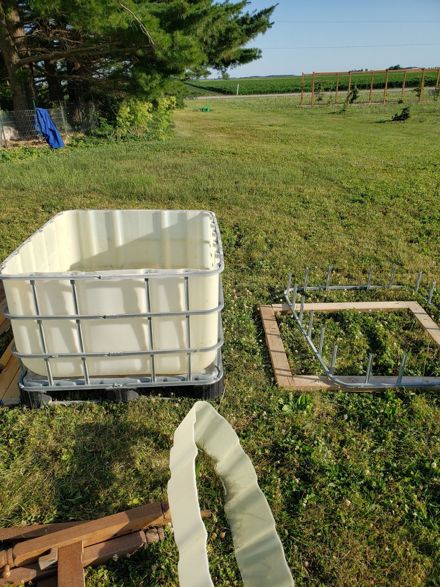
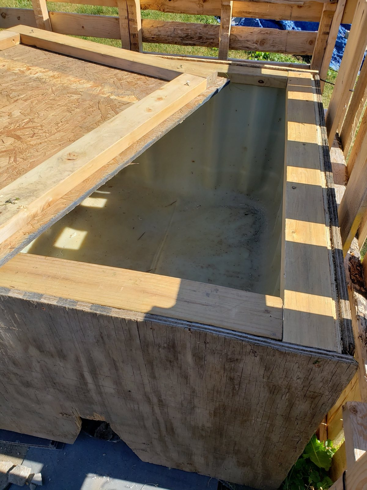
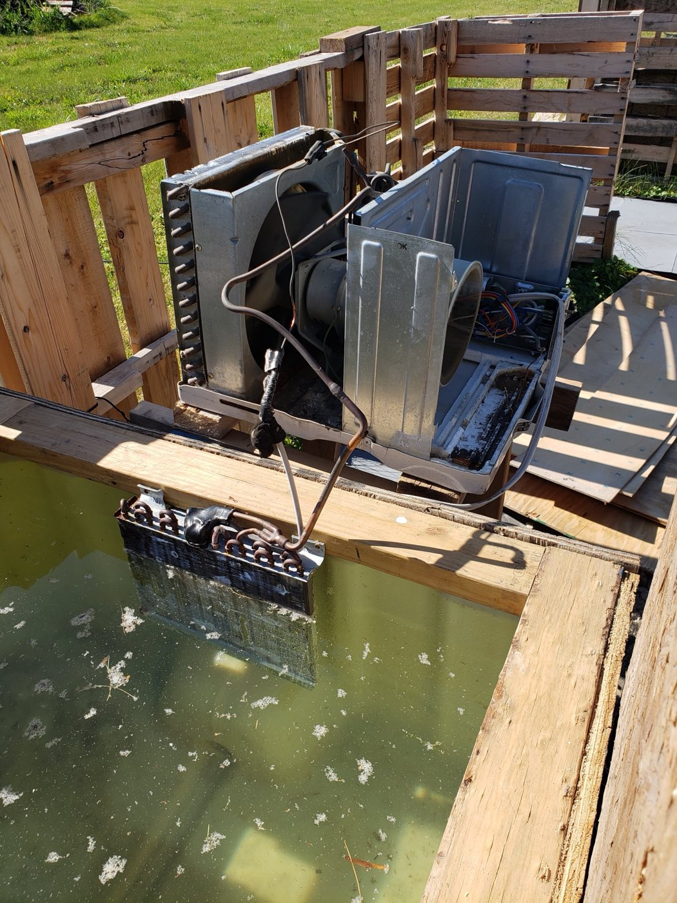
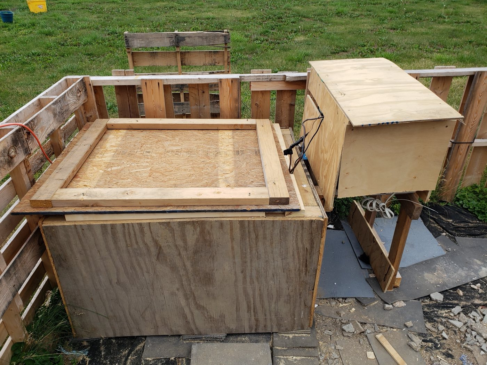
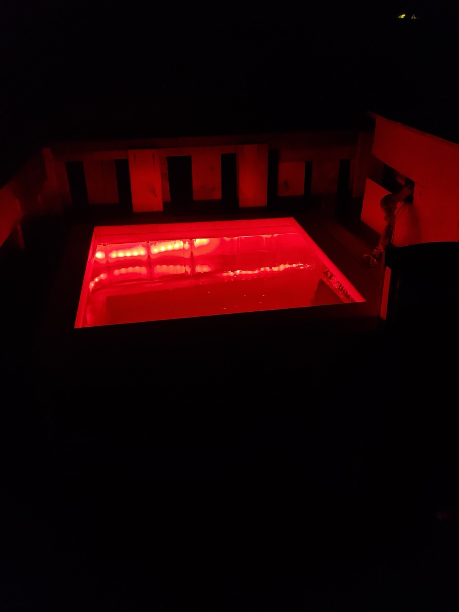
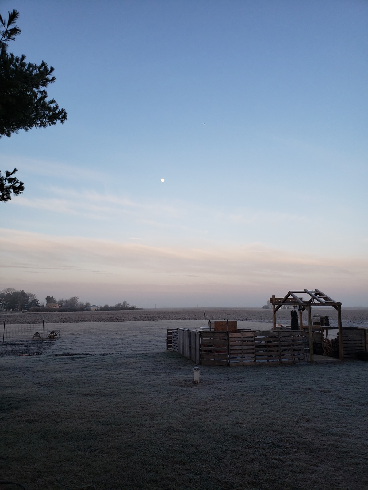
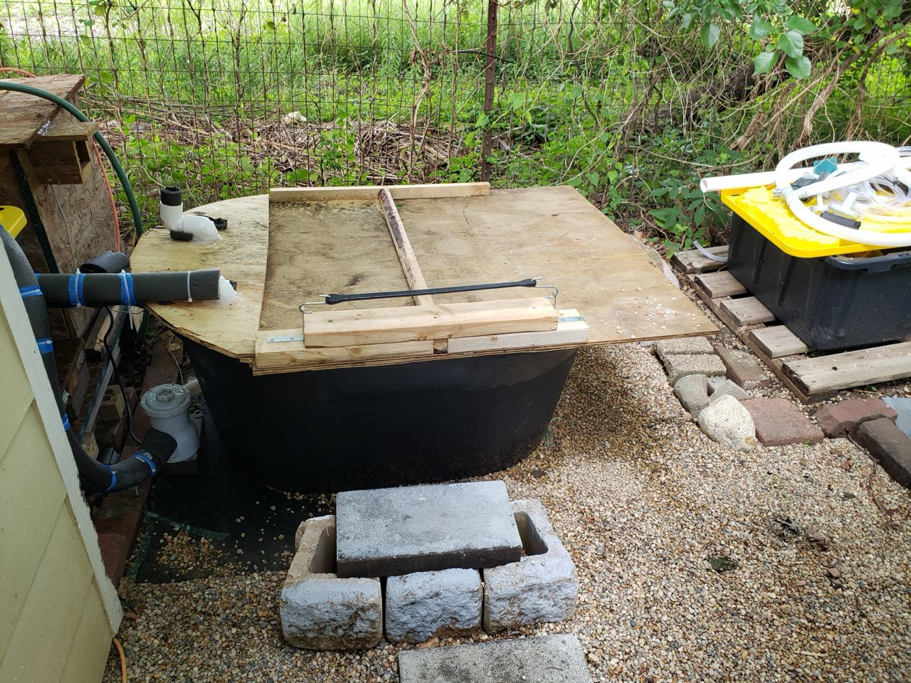
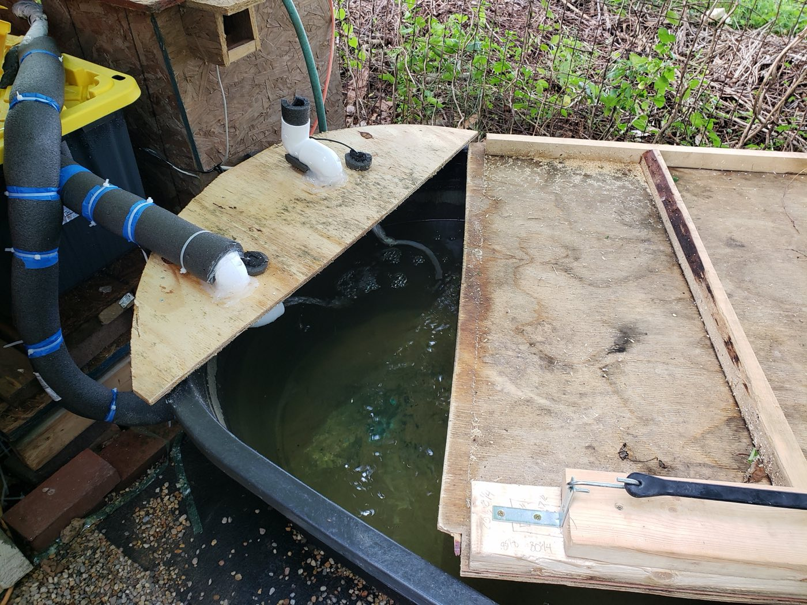
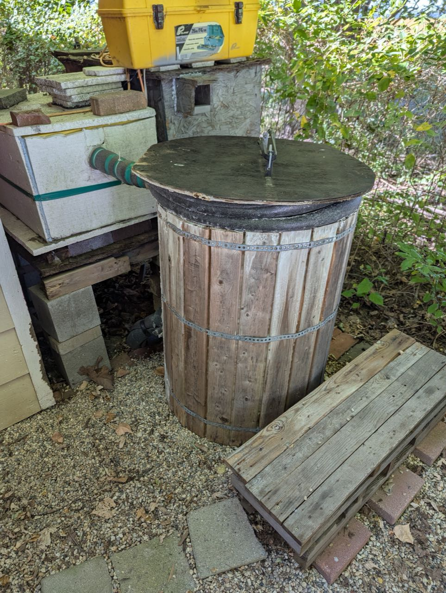

A commercial cold plunge costs thousands of dollars. Mine uses a window air conditioner I got for free, with its cold coils sunk straight into the water.

Over the years I've built three cold plunges, mostly from scrap and free or low-cost finds. None of them was perfect first time. Each one taught me something, and the current version is reliable, holds 42°F, and sits next to my [scrap wood sauna](/projects/scrap-wood-sauna/) for hot–cold contrast sessions. Here's the physics behind the chiller, the three builds and what I learned.

## At a glance

- **Chiller:** free window AC unit with its evaporator coils submerged in the water
- **Iterations:** agricultural crate (about 150 gal) → horse trough → barrel
- **Current temperature:** 42°F, running reliably for about 2 years
- **First-build parts:** about $250
- **Total spend across all iterations:** about $500 (commercial units start at $1,000)
- **Winter strategy:** drain the main tub and switch to salt water

## Why cold plunge?

Years ago I read about the benefits of cold-water immersion: less muscle soreness, a boost to metabolism, support for the immune system and a better mood. In short, a natural reset after workouts or stressful days [1].

Commercial cold plunge tubs often cost thousands of dollars, which was beyond my budget. So, as usual, I decided to build one from scavenged materials. It took research and plenty of trial and error, but it worked, and it has been well worth the effort.

## How a cold plunge works

A cold plunge means getting into chilled water, typically **40–55°F (4–13°C)**, for short periods (**2–10 minutes**) to trigger responses such as better circulation and less inflammation.

Ice baths get there by dumping in ice, which is messy and inconsistent. I wanted powered cooling that holds a steady temperature without being complicated to maintain.

## The AC-as-chiller idea

Chilling water cheaply was the hard part. I'd found a free agricultural crate to use as the tub, but I couldn't settle on how to cool it. I considered ice machines and small industrial chillers.

Then it occurred to me that a window AC unit might work. Its evaporator coils exist to pull heat out of their surroundings. They're designed to cool air, but water exchanges heat with a surface far more effectively than air does.

### The physics

Heat transfer at a surface follows Newton's law of cooling:

<strong>Q = h · A · ΔT</strong>

- **Q**: heat transfer rate (W)
- **h**: convective heat transfer coefficient (W/m²·K)
- **A**: surface area (m²)
- **ΔT**: temperature difference (K)

The coil's surface area (A) and temperature difference (ΔT) are the same whether it sits in air or in water. What changes is **h**:

| Property | Air | Water |
|---|---|---|
| Convective coefficient *h* (W/m²·K) | 10–100 (forced convection) | 500–10,000 |
| Specific heat capacity (J/kg·K) | 1,005 | 4,184 |
| Density (kg/m³) | 1.2 | 1,000 |
| Volumetric heat capacity (J/m³·K) | 1,005 × 1.2 ≈ 1,206 | 4,184 × 1,000 ≈ 4,184,000 |

Depending on flow conditions, water is roughly **5–100 times more effective** at transferring heat at the coil surface. Its volumetric heat capacity (specific heat × density) is **over 3,000 times** that of air, so each litre of water can absorb and release far more energy.

So if you put the AC unit's cold coils in water, the water pulls heat into the coils far faster than air would. That chills the plunge quickly and keeps it cold with little energy. It isn't how AC units are meant to be used, but the numbers work: water's heat-transfer properties turn an ordinary window unit into an effective chiller.

I found the AC unit for free on Freecycle. The only snag was its built-in temperature controller. Once I closed the ground circuit on that controller, the unit would switch on even on cool nights.

## Iteration 1: the agricultural crate

I built the first plunge in an outdoor gym area I'd set up while living with my brother and his family. He helped me clean the crate, which had been used for biofuels. After a lot of scrubbing with Purple Power degreaser, it came out clean.

<figure>
  
  <figcaption>Initial assembly of the agricultural crate plunge.</figcaption>
</figure>

The crate was the tub. I boxed it in with wood, leaving **air gaps** between the tub and the wooden exterior. The trapped air adds thermal resistance and acts as insulation.

<figure>
  
  <figcaption>Wood exterior and lid for the agricultural crate plunge.</figcaption>
</figure>

I screwed the AC unit's evaporator coil to the wooden frame so it hung in the water. Two water pumps kept water moving across the coils, which stops them freezing, and around the tub.

<figure>
  
  <figcaption>AC unit coil placement in the agricultural crate plunge.</figcaption>
</figure>

<figure>
  
  <figcaption>Final setup of the agricultural crate plunge.</figcaption>
</figure>

Over time I added upgrades: foam around the inside edges, an RGB LED light and a small stereo so I could listen to music while plunging.

With about **150 gallons** of water and the air-gap insulation, it stayed below **50°F for days** with very little run time, even in summer heat. Pairing it with outdoor training changed my daily routine. I came out of every plunge energized and focused.

<figure>
  
  <figcaption>Upgraded agricultural crate plunge with LED lighting.</figcaption>
</figure>

### Winter and salt water

Winter brought a new problem: freezing water could damage the coils. Starting in late summer, I drained the crate and switched to a **50-gallon barrel of heavily salted water**. Enough dissolved salt pushes the freezing point far below 32°F, so the water stays liquid well below normal freezing.

I acclimated gradually to colder and colder water, and by the end the barrel let me plunge in **13.5°F water for 2 minutes**. That showed me how much consistent exposure builds tolerance.

Eventually our families parted ways on good terms because we needed more space, and the crate plunge couldn't come with me when I moved. I still remember that outdoor workout and plunge setup fondly.

<figure>
  
  <figcaption>The outdoor gym and plunge area.</figcaption>
</figure>

### What the first build cost

I only bought the essentials for safety and function:

- A basic temperature controller, to automate the AC unit
- High-quality silicone caulk, for sealing
- Screws
- A heavy-duty outdoor extension cord
- Two water pumps, for circulation
- A filter housing with a string filter
- Mild, skin-safe water treatment chemicals (e.g., magnesium sulfate and sodium carbonate, for water balance and skin benefits)

Total: about **$250**, far less than a pre-built plunge tub.

## Iteration 2: the horse trough

After the move I started over. The first build had given me confidence, so I tried something more ambitious with a **horse trough** as the base: a **two-stage system**.

1. The main plunge bath.
2. A pump moves water from the bath into a **secondary cooling chamber** that holds the AC coils and two filters.
3. The water flows back down into the bath, clean and chilled.

<figure>
  
  <figcaption>Horse trough plunge with its cooling chamber.</figcaption>
</figure>

<figure>
  
  <figcaption>The finished horse trough setup.</figcaption>
</figure>

It worked at first, but the problems added up:

- **Too shallow.** The trough wasn't deep enough to submerge fully. My knees and upper body stuck out.
- **Rain got in.** Water seeped in through the lid, causing overflows that damaged parts.
- **The pump was too weak.** The pool pump couldn't push enough water up to the second stage, and it sometimes tripped the GFI circuit.

After one too many floods and tripped circuits, I gave up on the trough as a plunge and turned it into a family minnow pond. Then I went back to the drawing board.

## Iteration 3: the barrel

For the third build I used a **large barrel** as the tub. I kept the two-stage cooling with pumps and filters, but this time I could submerge fully.

- An **improved lid** insulates better and keeps the rain out, so the overflows stopped.
- I added **extra insulation** to the top stage and the filtration.
- I upgraded to a **better temperature controller**.
- It still runs on the **same AC unit from the first build**.

It runs reliably at **42°F**. It still has to be drained in winter, and I reuse the salt-water approach for the cold months. This plunge has now lasted about **two years**, and every session is still invigorating.

<figure>
  
  <figcaption>The finished barrel plunge with its improved lid.</figcaption>
</figure>

## The final tally

Across all three iterations I spent about **$500** on parts. Commercial units start at **$1,000**. The essentials:

- An upgraded temperature controller, to automate the AC unit
- High-quality silicone caulk, for sealing
- Screws
- A heavy-duty outdoor extension cord
- A high-volume fountain pump
- Mild, skin-safe water treatment chemicals (e.g., magnesium sulfate and sodium carbonate)

The barrel plunge is sturdy and efficient, and it pairs well with the sauna for hot–cold cycles.

## Lessons learned

- **Water volume and insulation do a lot of the work.** The 150-gallon crate with air-gap insulation stayed under 50°F for days with very little run time.
- **Depth matters more than you'd think.** If you can't get fully under, it isn't really a plunge. That's what sank the trough.
- **Rain-proof the lid.** A leaky lid caused overflows and damaged parts.
- **Size your pump for the job.** An underpowered pump won't feed a second stage and may trip the GFI.
- **Protect the coils from freezing.** Keep water moving across them, and drain for winter.
- **Start small and iterate.** Every version fixed the last one's biggest problem.

## Safety notes

- Use a **waterproof electrical setup** outdoors, and **consult a professional for wiring**.
- **Check water quality** regularly. Filtration and gentle, skin-safe treatment chemicals help.
- **Acclimate gradually** to colder water. Consistent exposure builds tolerance over time.

If you're handy and patient, a DIY cold plunge is well worth building. It takes time and plenty of tweaks, but the health benefits and the satisfaction are worth it.

## References

1. Healthline (2020). *What to Know About Cold Water Therapy.* Accessed September 8, 2025. <https://www.healthline.com/health/cold-water-therapy>
