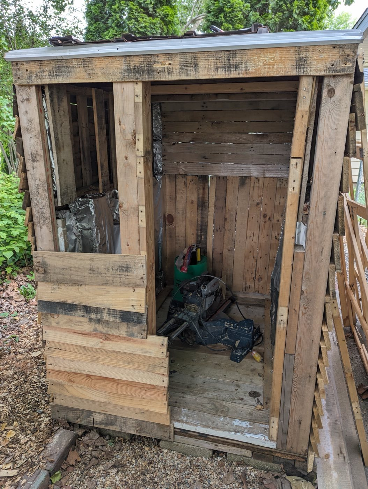
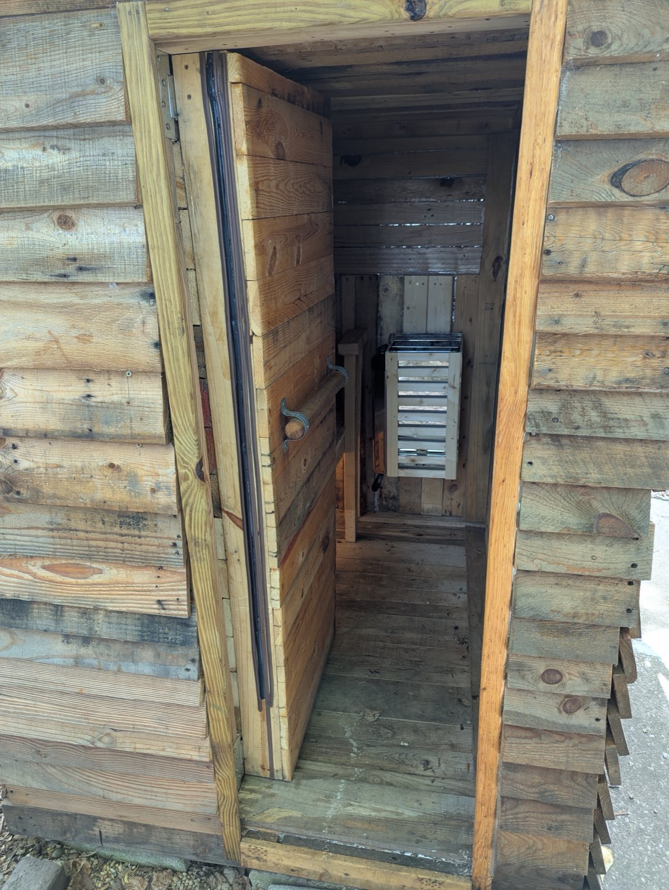
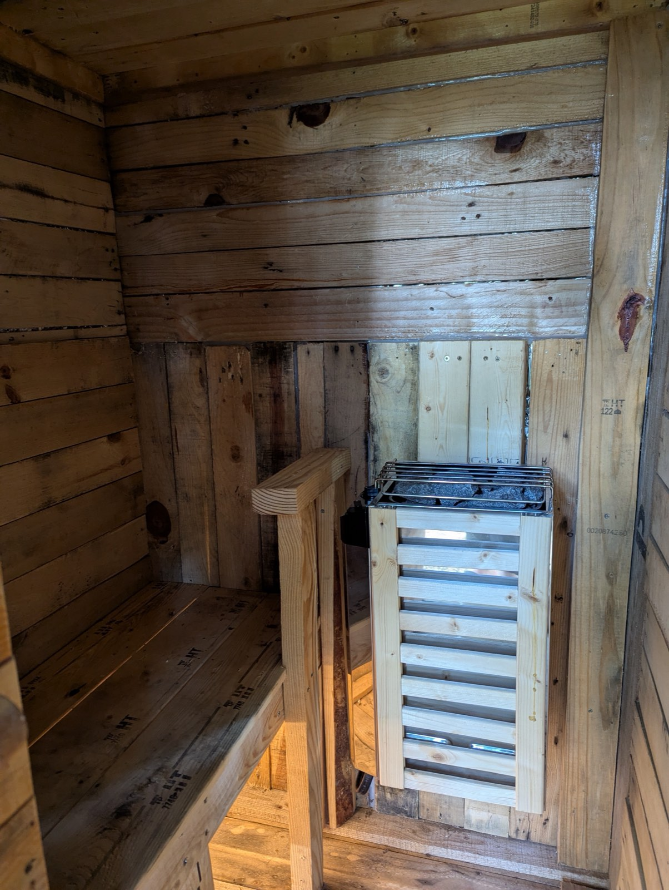
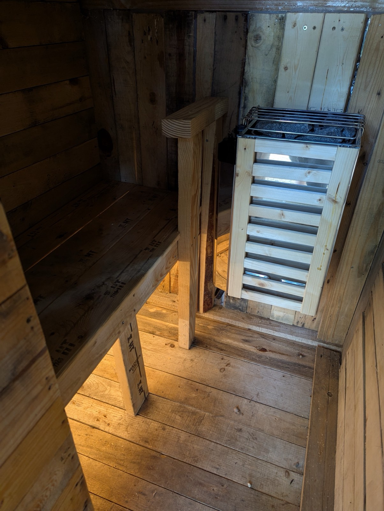

A pre-built sauna costs thousands of dollars. Mine cost about $450, and most of that went on the heater. The rest came from free scrap wood, old doors and heat-treated pallets.

It didn't work well at first. The first version leaked heat, mice moved into the roof, and at one point I sealed it so tightly that the heater couldn't get enough air. After a few rounds of fixes, it now reaches 180°F reliably. This is how I built it and what I learned along the way.

## At a glance

- **Type:** two-person outdoor dry sauna
- **Footprint:** 4 × 6 ft, about 5½ ft tall, on partially buried cinder blocks
- **Heater:** small 120 V electric unit (about 2 kW), on its own 40 A breaker
- **Power run:** about 75 ft of buried conduit
- **Total spend:** about $450, heater and wiring included (basic kits start at $2,000+)
- **Performance:** 180°F reliably, about 30 minutes to reach temperature
- **Build time:** many weekends

## Why I wanted one

It started after a hard jiu-jitsu session with my friend Alex. He invited me back to his place to unwind in his backyard sauna, and I was hooked. The heat took the soreness away and left me feeling reset, body and mind. It took me a session or two to get used to the heat.

I wanted my own, but when I looked online, pre-built saunas ran into the thousands of dollars, which was well beyond my budget. So I decided to see whether I could build one from free or scavenged materials. With some creativity and a lot of elbow grease, I could.

## Why a dry sauna

There are three main types of sauna:

- **Wet (steam):** water is poured over hot rocks to create humidity.
- **Infrared:** light waves heat your body directly.
- **Dry:** the air is heated with no added moisture.

I chose a dry sauna because it is the simplest to build and maintain in a DIY setup. Dry saunas typically use an electric heater or a wood-burning stove to warm the air to 150–195°F (65–90°C) at low humidity, around 10–20%. That heat is comfortable and breathable. It encourages deep sweating, relaxes muscles and improves circulation (Healthline, 2023). For an outdoor build, dry heat also meant less worry about long-term moisture damage.

I'll be honest: because the sauna sits outdoors, I have little control over humidity. On humid days I drop the temperature closer to 150°F, and it is still a great session.

## Sourcing materials: mostly free

The key to keeping costs down was getting most of the materials for free. I searched Freecycle.com and Craigslist for free scrap wood, old doors and other odds and ends. I also collected a lot of heat-treated pallets from local businesses. They often throw these away, and they are ideal for upcycling.

### A word on pallets

Not every pallet is safe to use in an enclosed, heated space like a sauna. Check the IPPC stamp:

- **HT (heat-treated):** the wood was heated to at least 56°C for 30 minutes to kill pests. It is chemical-free and safe to use.
- **MB (methyl bromide):** the wood was fumigated with a chemical that can off-gas harmful substances. **Don't use these pallets.**

(Pallet 101, 2023; Wooden Pallet Association, 2024.) I also checked every pallet for stains, odors or other signs of chemicals before I used it.

### What I actually bought

I only paid for things that mattered for safety or function:

- Aluminum foil, for a vapor barrier and heat reflection
- Red Devil fireplace silicone caulk, which handles high heat, for sealing gaps
- Nails and screws
- Outdoor LED lights
- Wiring and conduit, to run power safely to the sauna
- A small 120 V electric sauna heater (about 2 kW), an affordable model rated for small spaces

All of that, heater included, came to about **$450**.

<figure>
  
  <figcaption>Building the sauna: pallet frame, foil-lined walls and the start of the overlapping siding.</figcaption>
</figure>

## The build

### Version 1: the basic box

I set cinder blocks partly into the ground and built a 4 × 6 ft box on top of them, about 5½ ft tall, which is enough to sit comfortably. The frame is heat-treated 2×4 scraps and whole pallets.

Before I put up the pallet-wood walls, ceiling and floor, I lined the inside with aluminum foil as a wind and weather barrier and sealed the joints with the fireplace caulk. The door was also pallet wood and foil. I didn't add any insulation at this stage because I didn't think it would need any.

On the outside, I fixed pallet boards in an overlapping siding pattern, which gives it an old-cabin look that suits it. For the roof, I got hold of some newer metal roofing and fixed it to a slightly sloped frame so rain runs off.

### Power: 75 feet of trench

I went with a small 120-volt heater from Amazon (about 2 kW) on its own 40 A breaker. The sauna is a long way from the electrical box, so the sensible option was to bury a line in conduit.

I dug a fairly deep trench about **75 feet long**, ran the wire through the conduit, glued the conduit together and wired up both ends. The trench was the hard part because I kept hitting roots. Everything else went smoothly, and the run looks clean and is watertight.

### Iteration 1: it worked, but it leaked

The first version worked. In winter (December–January) it held temperatures up to **150°F**. But it was leaky. Heat escaped through gaps in the walls and around the door, and on gusty days I could feel a breeze across the floor. Sessions were fine, but it took a long time to heat up and never got as hot as I wanted.

### Iteration 2: insulation and a hot zone

To stop the leaks, I added **rockwool insulation**, which is fire-resistant and handles high heat well. It went into the upper half of the walls and into some of the lower sections. The pallets made this easy because their structure already forms compartments.

This created two zones:

- a **hot zone** in the upper three-quarters of the sauna for the most intense heat
- a **cool zone** lower down, near your feet, for when you need to cool off a little

I also added more layers of aluminum foil to reflect heat back inside. After that, temperatures climbed faster and held steady. The door still leaked, but I decided I could live with it for now.

### Iteration 3: the mouse incident

Then the mice arrived. During a cold spell they nested in the roof insulation, chewed through it and made a mess. I had to tear the roof off and rebuild it.

This time I stuffed **steel wool** into every possible entry point (mice hate it), added more foil layers as a barrier and finished the roof with three layers of wood for durability.

### Iteration 4: too airtight

That left the door. I added cheap **EPDM weather stripping**, a flexible rubber seal, and overdid it. The sauna became so airtight that the heater couldn't get enough air, and heat-up times got slower.

The fix was a simple **air inlet vent** through the back wall near the base of the heater, pest-proofed like everything else. Airflow improved dramatically, and the sauna now reaches temperature in about **30 minutes**. Air circulation matters in a dry sauna: it drives convection and keeps the room from feeling stuffy without losing heat.

<figure>
  
  <figcaption>The sauna is done.</figcaption>
</figure>

## The final tally

All in, I spent about **$450**, including the wiring, the heater and supplies. Basic kits from sauna companies start at **$2,000+**. The two-person sauna now reaches **180°F** reliably, even in cooler weather, and I use it after workouts and on tough days.

<figure>
  
  <figcaption>Interior of the finished sauna. You can still see the HT stamps on the bench boards.</figcaption>
</figure>

<figure>
  
  <figcaption>Interior of the finished sauna, looking toward the heater.</figcaption>
</figure>

## What I'd do differently

- **Insulate from day one.** I skipped insulation at first, and leaks and slow heat-up were the result. Rockwool in the pallet cavities made the biggest difference of any fix.
- **Pest-proof before you insulate.** Insulation is good nesting material for mice. Steel wool and sealed entry points from the start would have saved me rebuilding the roof.
- **Seal, but plan for airflow.** A tight door is good. A completely sealed room starves the heater. Add an inlet vent near the heater base.
- **Expect the trench to be the hardest part.** Digging 75 feet through roots took more effort than anything else in the build.

## Safety notes

- Use **heat-treated (HT) pallets only.** Avoid MB-stamped pallets, and check for stains or odors.
- Use **fire-resistant insulation** such as rockwool, and high-heat caulk around the heat.
- Run power through **buried, sealed conduit** on a properly sized breaker, and **check your local codes for electrical work**.
- On humid days, turn the temperature down. Around 150°F is still very effective.

If you're handy and willing to hunt for materials, I highly recommend building your own. Mine took many weekends, but sitting in a sauna I built from scraps makes the time worth it.

## References

- Healthline. (2023). *Sauna: Health benefits, risks, and precautions.* Accessed August 20, 2025. <https://www.healthline.com/health/sauna-benefits>
- Pallet 101. (2023). *Understanding pallet stamps: HT vs. MB.* Accessed August 20, 2025. <https://www.pallet101.com/understanding-pallet-stamps>
- Wooden Pallet Association. (2024). *Guide to heat-treated pallets and safety.* Accessed August 20, 2025. <https://www.woodenpalletassociation.org/guide-to-heat-treated-pallets>
